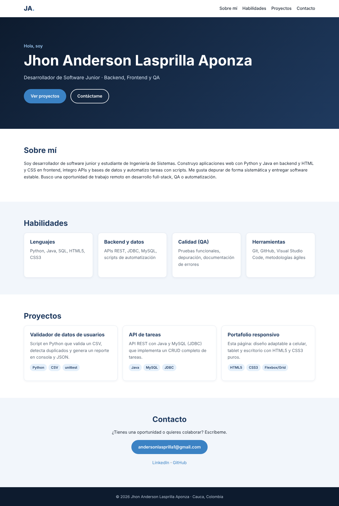
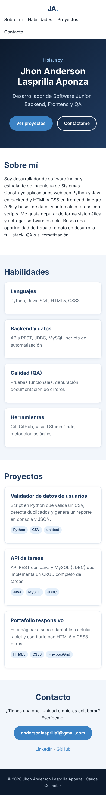

# Portafolio personal responsivo (HTML + CSS)

Página de portafolio de una sola pantalla de scroll, hecha solo con **HTML5 y CSS3** (sin frameworks ni JavaScript),
que se adapta a celular, tablet y escritorio.

## Qué incluye
- Encabezado fijo con navegación por secciones.
- Sección principal (hero), sobre mí, habilidades, proyectos y contacto.
- Diseño adaptable con CSS Grid, Flexbox y una media query para pantallas pequeñas.
- Variables CSS para los colores y tipografía fluida con `clamp()`.
- HTML semántico (`header`, `main`, `section`, `article`, `footer`) y etiquetas de accesibilidad.

## Tecnologías
HTML5 · CSS3 (Grid, Flexbox, variables, media queries)

## Capturas

**Escritorio**



**Móvil**



## Cómo verla
Abre `index.html` en el navegador, o publícala gratis con GitHub Pages
(Settings → Pages → Branch `main` → carpeta `/root`).

## Estructura
```
portafolio-responsivo/
├── index.html
├── css/styles.css
└── docs/          # capturas
```

## Autor
Jhon Anderson Lasprilla Aponza · [LinkedIn](https://www.linkedin.com/in/jhon-anderson-lasprilla-aponza)
